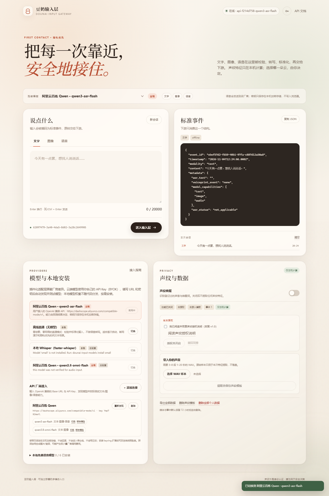

# 豆奶输入层 · Dounai Input Gateway

> 把每一次靠近，安全地接住。



豆奶输入层是 AI 情感助手最前端的**多模态输入与外部接入层**。它负责接收文字、图像和语音，把不同来源与不同厂商的差异收敛为一个稳定、可审计的标准事件，再交给下游处理模块。

本仓库可独立运行、独立演示、独立测试，不依赖任何其他业务模块。

- 文字 / 图像 / 语音统一事件契约（v1.1），**严格**只输出约定字段；ASR 不可用有显式状态
- 统一 provider 适配层，声明能力（text / image / audio），插件化安装与卸载
- 可选本地模型：faster-whisper 完全离线转写，权重按需下载、不入库
- OpenAI 兼容 API 接入：只填 Base URL + API Key，自动发现模型并逐项实测文字/图像/语音能力
- 一个连接保存多个模型，随时切换；密钥 AES-256-GCM 加密入库，可选系统钥匙串
- 第三方推荐：阿里云百炼 **Qwen3-ASR-Flash**（BYOK，用户自备密钥）
- 本地声纹唤醒：MFCC 特征在内存中提取，模板只保存在本机
- 运行时切换模型，会话上下文保留；失败时按能力与隐私边界降级
- 明确授权、隐私开关、数据导出、声纹删除、全部个人数据删除
- 单文件 SQLite、零 Node 构建依赖的 Web 控制台、完整用户与开发文档
- 跨机会话/媒体交付：响应头回传会话，媒体可用鉴权 base64 接口读取

## 快速开始

需要 Python 3.11 或 3.12（推荐 3.12）。

```bash
git clone https://github.com/zhipianxiaokonglong/Dounai_input.git
cd Dounai_input

python -m venv .venv
# Windows: .venv\Scripts\activate
# macOS / Linux: source .venv/bin/activate
pip install -e .

dounai-input serve
```

打开 <http://127.0.0.1:8000/>。首次启动默认使用**离线直通**模型，不需要网络、密钥或模型权重；可以直接发送文字和图像，语音事件也会正常生成，但不会自动转写。

发送第一条文字事件：

```bash
curl -X POST http://127.0.0.1:8000/v1/inputs/text \
  -H "Content-Type: application/json" \
  -d '{"text":"今天有点累，想找人说说话。","source":"curl"}'
```

响应就是一个严格符合契约的事件：

```json
{
  "event_id": "…",
  "timestamp": "2026-10-24T09:30:00.000Z",
  "modality": "text",
  "content": "今天有点累，想找人说说话。",
  "metadata": {
    "asr_text": "",
    "asr_status": "not_applicable",
    "voiceprint_event": "none",
    "model_capabilities": ["text", "image", "audio"]
  }
}
```

`asr_status` 是契约 v1.1 新增字段：`completed` / `empty` / `unavailable` /
`not_applicable`。旧 v1.0 消费方仍可解析事件；新消费方必须读取它，禁止在
`asr_status` 不是 `completed` 时把 `asr_text` 当作有效文本。

## 三种形态，一个出口

| 输入 | 请求 | `content` |
| --- | --- | --- |
| 文字 | `POST /v1/inputs/text` JSON | 用户原文 |
| 图像 | `POST /v1/inputs/image` multipart | 受控媒体 URL |
| 语音 | `POST /v1/inputs/audio` multipart | 受控媒体 URL，转写结果与状态在 `metadata.asr_text` / `metadata.asr_status` |

会话标识通过响应头 `X-Dounai-Session` 稳定回传（事件体不加重字段，保持 v1.0
兼容）。跨机或云端消费方无法访问 `content` URL 时，使用已鉴权的
`GET /v1/media/{id}/base64` 或 `GET /v1/events/{id}/media?include_base64=true`
直接取得字节。

完整接口、错误码与 curl 示例见 [docs/api.md](docs/api.md)，机器可读契约见 `GET /v1/contract`。

## 本地免费模型（可选）

核心包不安装、也不捆绑模型权重。需要离线语音转写时：

```bash
pip install -e ".[local-asr]"
dounai-input models install small
dounai-input providers activate local-whisper
```

`small` 约 466 MB，中文与 CPU 速度平衡。还提供 tiny / base / medium / large-v3 / large-v3-turbo 档位，`dounai-input models list` 可查看。权重下载到本机数据目录，**不会**进入 Git 仓库。详见 [docs/user-guide.md](docs/user-guide.md)。

## 接入第三方 API（BYOK）

本层不内置任何厂商的静态配置，也不提供账号或密钥。所有 OpenAI 兼容服务都在
Web 控制台的 **API 厂商接入** 里现场接入：

1. 打开控制台，点“添加连接”，选择预设（阿里云百炼 / OpenAI / OpenRouter /
   SiliconFlow / 本机 Ollama）或直接填写 Base URL；
2. 填入自己的 API Key，点“发现模型”，从返回的模型列表里勾选；
3. 点“测试能力”，实测所选模型的文字、图像与语音（含转写协议）；
4. 保存后即可在模型下拉框里切换，一个连接可保存多个模型。

命令行或脚本也可以直接调用同一套接口：

```bash
curl -X POST http://127.0.0.1:8000/v1/api-connections/discover \
  -H "Content-Type: application/json" \
  -d '{"base_url":"https://dashscope.aliyuncs.com/compatible-mode/v1","api_key":"sk-你的密钥"}'
```

探测、保存与删除的完整字段见 [docs/api.md](docs/api.md#api-连接byok)。

密钥只以 AES-256-GCM 密文保存在本机 SQLite，响应、日志、导出与换机迁移都不会
包含明文；主密钥默认在 `data/.secret.key`，安装 `.[keyring]` 并把
`DOUNAI_SECRET_BACKEND` 设为 `keyring` 后可改存系统钥匙串。删除全部个人数据时
连接与主密钥一并清除。推荐厂商与逐图指引见 [docs/user-guide.md](docs/user-guide.md)。

## 声纹与隐私

声纹功能**默认关闭**，并且需要三步同时满足才会产生 `wakeup`：

1. 用户明确同意声纹处理（政策 v1.0）；
2. 开关开启；
3. 已录入本机声纹模板，并且转写文本包含唤醒词（默认“你好豆奶”）。

特征提取在本机内存完成，模板只写入本地 SQLite，不发送给任何 provider、不进入日志。可随时在 Web 控制台或 API 撤回同意、删除模板、导出数据或删除全部个人数据。技术实现、限制与风险见 [docs/privacy.md](docs/privacy.md)。

> 本项目的声纹实现是可解释基线，不是身份认证或安全决策系统。

## 配置

默认配置即可运行。需要定制时：

```bash
cp dounai.example.toml dounai.toml
cp .env.example .env   # 可选；.env 已被 .gitignore 排除
```

常用环境变量：

| 变量 | 作用 |
| --- | --- |
| `DOUNAI_CONFIG` | 指定 `dounai.toml` |
| `DOUNAI_DATA_DIR` | 数据目录，默认 `./data` |
| `DOUNAI_API_TOKEN` | 非回环地址部署时的 Bearer Token |
| `DOUNAI_SECRET_BACKEND` | 主密钥位置：`auto` / `file` / `keyring` |
| `DOUNAI_VOICEPRINT_ENABLED` | 初始声纹开关（运行时开关优先） |

完整变量与配置项见 [.env.example](.env.example) 与 [docs/deployment.md](docs/deployment.md)。

## 测试与质量

```bash
pip install -e ".[dev]"
pytest
ruff check src tests
```

边界情况、故障注入、降级行为与根因分析记录在 [docs/testing-report.md](docs/testing-report.md)。

## 项目结构

```text
src/dounai_input/
  api.py              HTTP 路由与安全中间件
  events.py           冻结的事件契约
  ingest.py           三模态校验与事件编排
  providers/          provider 接口、注册表、内置适配器
  api_access.py       厂商 URL 策略、模型发现与能力探测
  api_connections.py  连接/密钥/模型生命周期与动态 provider
  secrets.py          AES-256-GCM 密钥存储（可选系统钥匙串）
  voiceprint.py       本地 MFCC 声纹提取与唤醒判断
  privacy.py          授权、导出、删除、保留期
  store.py            SQLite 持久化
  model_catalog.py    本地模型目录与安装器
  web/                零构建控制台
docs/                 用户、开发、API、隐私、部署与测试报告
tests/                单元、集成与故障注入测试
```

## 文档

- [用户指南：安装本地模型、填写第三方密钥、隐私开关](docs/user-guide.md)
- [开发指南：新增 provider、插件、接口规范](docs/developer-guide.md)
- [API 参考](docs/api.md)
- [架构说明](docs/architecture.md)
- [隐私与安全设计](docs/privacy.md)
- [部署指南](docs/deployment.md)
- [测试与根因分析报告](docs/testing-report.md)
- [示例：设备客户端](examples/device_client.py) · [示例：独立 provider 插件](examples/example-provider/)

## 许可证

代码以 [MIT License](LICENSE) 开源。模型权重与第三方 API 分别受其自身许可证与服务条款约束，详见 [docs/user-guide.md](docs/user-guide.md)。
