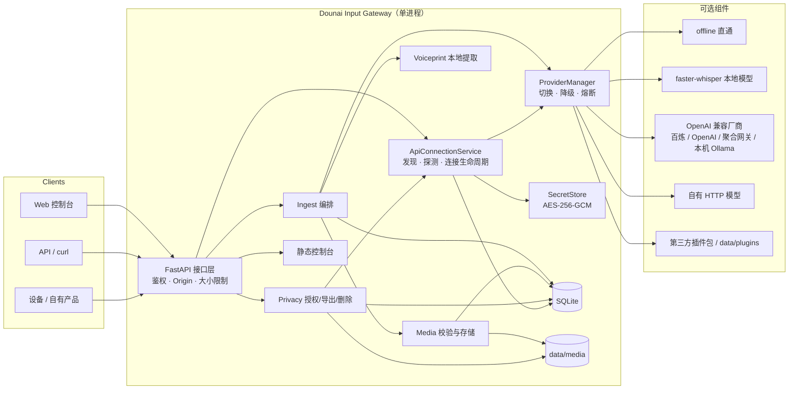
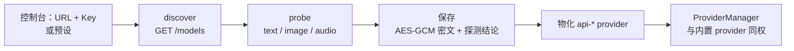
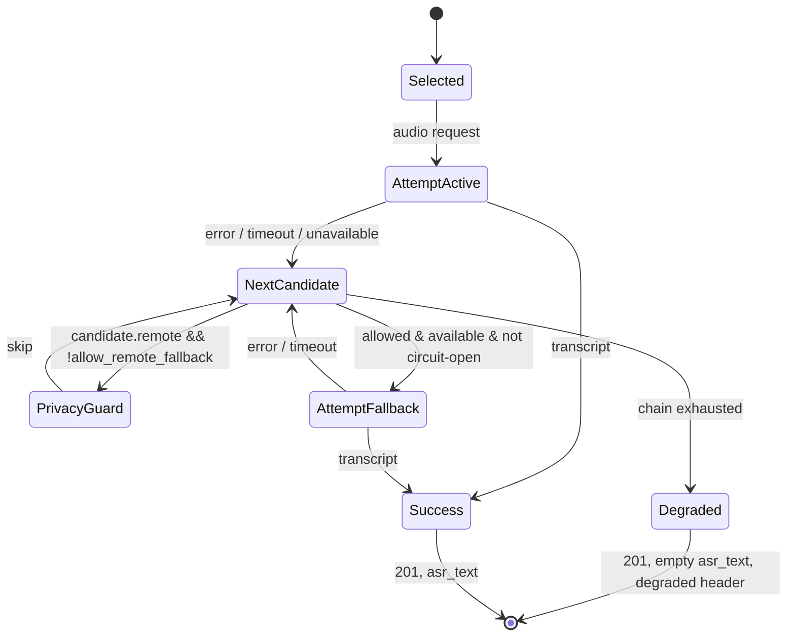

# 架构说明

> 包版本 **0.2.0**，事件契约 **v1.1**，SQLite schema **v3**。第三方厂商通过运行时的
> “API 连接”（Base URL + API Key）接入，不再有静态厂商 provider 或厂商环境变量。

## 1. 目标与非目标

**目标**

- 接收文字、图像、语音，完成校验、媒体存储、必要的语音转写与本地声纹判断；
- 输出一个稳定、严格、可被下游独立消费的事件；
- 用统一 provider 层屏蔽协议差异，支持运行时切换与失败降级；
- 让用户只填 Base URL 与 API Key 就能接入任意 OpenAI 兼容厂商：自动发现模型、逐项实测能力、保存后即可切换；
- 把生物特征与用户数据边界放在架构中心，而不是事后补丁；
- 可独立部署、演示、测试，不依赖其他业务模块。

**非目标**

- 不生成 AI 回复、不做情感分析或对话策略；这些属于下游；
- 不做多租户、账号体系、计费、设备配对和 OAuth；
- 不做生产级说话人识别/防伪；
- 不把图片内容理解强行塞进事件。事件携带图片引用，理解由下游模型完成；
- 不提供厂商账号或 API Key，也不做厂商账号托管、额度管理或请求代理；
- 不认证厂商能力：探测通过只代表“本机此刻可调用”，不是厂商 SLA 或密码学证明。

## 2. 总体结构



单进程是刻意的：隐私边界、SQLite 事务、媒体目录、声纹模板和加密密钥都在一个用户账户下，
部署/备份/删除更容易解释。代价是不能水平扩展，见第 8 节。

API 连接是“数据”，不是“配置”：连接与模型存在 SQLite，主密钥独立于数据库；服务启动或
连接变更时，`ApiConnectionService` 把它们物化成 `api-*` provider 注册进 `ProviderManager`，
之后与内置 provider 走完全相同的选择、降级与熔断路径。

## 3. 请求生命周期

以语音为例：

1. **HTTP 层**：Bearer 鉴权、Origin/Sec-Fetch-Site 校验、Content-Length 上限、请求 ID。
2. **Ingest**：规范化 `session_id`/`source`，读取音频字节并做魔数校验；不是只信 `Content-Type`。
3. **Media**：原子写入 `data/media/<uuid>.<ext>`，记录 SHA-256/mime/size；内容 URL 由 `public_base_url` 生成。
4. **Context**：从 `events` 查询该 session 最近 N 条文字/转写。
5. **ProviderManager**：active provider → fallback 链；active 可以是本地模型，也可以是某个 API 连接下的 `api-*` 模型，二者走同一路径；每次尝试受超时、能力、隐私守卫、熔断控制。
6. **ASR**：成功得到文本；成功但空文本记为 `empty`，失败/无可用 provider 记为 `unavailable`，均不阻断事件。
7. **Voiceprint**：若开关、授权、模板齐全且是 WAV，本地提取、比较、结合唤醒词；任何异常降级为 `none`。
8. **Event**：构造版本化 Pydantic 模型（`metadata.asr_status`），写入 SQLite；响应头携带会话/降级/ASR 状态/模型信息。
9. **下游**：获得事件，按 `content` 拉取媒体（跨机用 base64 接口），按需消费 `asr_text`/`asr_status`/`voiceprint_event`/能力。

文字与图片不调用 provider 转写。文字已是最终内容；图片以引用交给下游。接入厂商不会改变这一点：
本层只在语音需要转写时才把音频发给 active provider，不会把事件、图片或声纹顺带外发。

连接被删除或模型被删除时，active 若指向该 `api-*` provider，会同步回退到本地 provider
（见 5.4）。密钥无法解密时，该模型对应的 provider 会在同步时被注销、从列表消失；转写会走
fallback 链，用户需要重新保存连接密钥。

## 4. 组件职责

| 组件 | 负责 | 不负责 |
| --- | --- | --- |
| `api.py` | 路由、鉴权、安全中间件、错误映射、静态资源 | 业务规则、模型调用 |
| `ingest.py` | 三模态校验、会话/来源规范化、转写和声纹编排 | HTTP、SQL |
| `media.py` | 魔数识别、大小限制、原子落盘、路径安全 | 图像内容理解 |
| `providers/base.py` | Provider 协议、能力/隐私声明、尝试轨迹 | 具体厂商协议 |
| `providers/registry.py` | 内置/entry point/目录插件发现、动态注册与注销 | 选择策略 |
| `providers/manager.py` | active、fallback、超时、熔断、隐私守卫、动态 provider 生命周期 | 厂商 HTTP 细节 |
| `api_access.py` | URL/SSRF 策略、模型发现、能力探测、厂商预设 | 持久化、密钥解密 |
| `api_connections.py` | 连接 CRUD、密钥加解密编排、provider 物化/注销/回退 | 厂商协议细节、HTTP 路由 |
| `secrets.py` | 主密钥管理（文件/钥匙串）、AES-GCM 加解密、密钥指纹 | 业务语义、网络 |
| `voiceprint.py` | 本地特征、模板、相似度、唤醒判断 | 生物特征上云 |
| `store.py` | SQLite、事件、媒体元数据、API 连接、授权、审计、导出/删除 | 文件内容 |
| `privacy.py` | 政策、授权生命周期、ZIP 导出、保留期、全量删除 | 身份认证 |
| `model_catalog.py` | 模型元数据、下载、校验、删除 | 运行时加载 |
| `web/` | 演示与人工操作界面（含“API 厂商接入”对话框） | 业务逻辑、模型调用 |

## 5. Provider 适配层

### 5.1 能力与角色

`ProviderManifest` 声明：

- `capabilities`：模型可接收的模态（text/image/audio）。这是给下游/运维的声明；
- `can_transcribe`：本层是否会把音频交给它并期待 `text`；
- `privacy`：`local` 或 `remote`。它决定降级守卫与 UI 提示；
- `requires_api_key`：是否 BYOK。

provider 有三个来源，但进入 manager 后没有区别：

| 来源 | 典型 id | `capabilities` 从哪来 | 密钥从哪来 |
| --- | --- | --- | --- |
| 内置 | `offline`、`local-whisper`、`custom-http` | 代码声明 | 无，或插件配置的 `*_env` 变量 |
| 插件 | entry point / 目录插件自定义 | 代码声明 | 插件自定 |
| API 连接 | `api-<连接短号>-<模型 slug>` | 保存前逐项探测的结果 | SQLite 密文，运行时用本机主密钥解密 |

`api-*` provider 的 manifest 由 `ApiConnectionService` 在物化时生成：`privacy="remote"`、
`requires_api_key=True`、`can_transcribe = "audio" in capabilities`。provider id 由服务端生成，
客户端不能指定，避免伪造/覆盖内置 provider。

当前输入层只主动调用 `transcribe()`。文字/图片不经过模型，避免改变用户内容；`capabilities`
中 text/image 的意义是“该模型生态支持这些输入”，为后续下游选型和 UI 展示保留声明。新增能力
（如 image caption）需要契约升级，不能偷偷塞进 metadata。

### 5.2 协议差异的收敛

`openai_compatible.py` 是一个**通用**适配器，不再绑定厂商 profile 或环境变量；URL、模型、
密钥都由连接显式传入。它覆盖以下形态：

| 协议 | 端点 | 用途 | 典型 |
| --- | --- | --- | --- |
| `chat_completions`（text） | `POST /chat/completions`，短文本 | 文本能力探测 | 所有 OpenAI 兼容服务 |
| `chat_completions`（image） | `POST /chat/completions`，`image_url` 为 data URL | 图像能力探测 | 多模态模型 |
| `audio_transcriptions` | `POST /audio/transcriptions` multipart | 语音转写 | OpenAI、Azure、多数网关 |
| `chat_audio` | `POST /chat/completions`，base64 `input_audio` | 语音转写 | Qwen3-ASR、部分网关 |

“OpenAI 兼容”不是单一协议，所以转写协议在保存时由探测结果确定（`transcription_protocol`），
运行时不再猜测。厂商差异（字段、编码、错误码）只存在于 adapter；manager 只看到
`TranscriptionResult` 或 `ProviderError`。

### 5.3 API 连接：运行时厂商接入

一个连接 = 一个 `base_url` + 一份 API Key + 1–20 个已探测模型。同一厂商的多个模型共享连接，
但每个模型各自成为一个 provider，可单独切换、单独删除。



对外端点（详细字段见 [api.md](api.md)）：

| 方法 | 路径 | 作用 |
| --- | --- | --- |
| `GET` | `/v1/api-presets` | 预设厂商、推荐模型、所需权限提示 |
| `POST` | `/v1/api-connections/discover` | 用临时 URL+Key 调 `GET /models`，不落库 |
| `POST` | `/v1/api-connections/probe` | 对单个模型实测 text/image/audio，不落库 |
| `POST` | `/v1/api-connections` | 保存连接与已探测模型（201） |
| `GET` | `/v1/api-connections`、`/{id}` | 读取连接；只回密钥指纹 |
| `PATCH`/`DELETE` | `/v1/api-connections/{id}` | 改名/换 URL/轮换 Key/删除连接 |
| `POST` | `/v1/api-connections/{id}/refresh` | 用已存 Key 重新发现模型 |
| `POST` | `/v1/api-connections/{id}/models/{model_id}/probe` | 重测并覆盖该模型能力 |
| `DELETE` | `/v1/api-connections/{id}/models/{provider_id}` | 删除单个模型 |

**发现**：`GET {base_url}/models`，`Authorization: Bearer <key>`；接受 `data` 或 `models`
数组，元素可以是字符串或 `{id, owned_by}`；去重、截断到 500 个、响应体上限 2 MB；不跟随重定向。

**探测**：只用合成数据，绝不发送用户事件、媒体或声纹：

- `text`：一条极短 chat 请求；
- `image`：1×1 合成 PNG 的 `image_url`；
- `audio`：先试 `/audio/transcriptions`（0.8 秒合成 WAV），失败再试 `chat/completions` +
  `input_audio`；成功即记录 `audio_transcriptions` 或 `chat_audio`。

结果状态为 `supported / unsupported / error / not_tested`，并带延迟。`capabilities` 只取
`supported` 项。鉴权失败会短路后续探测，避免用错误的 Key 反复打厂商。

**保存约束**：至少一个模型；每个模型至少一项 `supported`，否则拒绝保存；音频可用时必须带
合法协议；最多 20 个模型；写入失败会回滚刚插入的连接行。探测结论由提交方给出，服务端按状态
重算能力但不重放探测——这是本机单用户信任模型，不构成密码学证明（见第 7 节）。

**物化与同步**：`_sync_providers()` 在服务构造、启动、连接新增/修改/删除、模型删除、重测、
全量删除后运行：

1. 为每个 `api_models` 行构造 `OpenAICompatibleProvider`，解密对应连接的 Key，`register_dynamic`；
2. 已不存在或 Key 无法解密的 `api-*` provider 一律 `unregister_dynamic`；
3. 若 active 指向已消失的 `api-*`，调用 `fallback_active()` 回退。

删除最后一个连接时，`delete_connection()` 还会删除主密钥（已无密文需要它）。

### 5.4 切换与降级状态机



要点：

- 选择是**运行时**的，持久化到 `settings.active_provider`；值可以是内置 id，也可以是 `api-*`；
- provider 健康状态（熔断）只在内存，重启清空；
- 失败是**可观测但不致命**的：响应头、日志、管理端状态；
- 默认不允许任何非 active 的远程 provider 作为 fallback；`api-*` 的 `privacy` 恒为
  `remote`，因此同样受 `allow_remote_fallback` 约束，云端降级必须显式开启；
- 切换时上下文不迁移 provider 状态，而是从持久化事件重新读取，避免厂商绑定；
- 连接/模型被删除时 active 会回退：优先 `offline`，其次 `[models].fallback`，再退到第一个
  已注册 provider。

### 5.5 插件发现

启动时按顺序：

1. 内置 provider（`offline`、`local-whisper`、`custom-http`，由 `[providers.*].enabled` 控制）；
2. Python entry point 组 `dounai_input.providers`；
3. `data/plugins/*.py` 与 `DOUNAI_PLUGIN_PATH` 中模块级 `PROVIDER`；
4. 从 SQLite 读取 API 连接，为每个已保存模型物化 `api-*` provider（不是插件，不进
   `plugin_errors`；Key 无法解密的模型会被跳过并记录告警日志）。

插件失败只记录到 `plugin_errors`，不阻止服务启动。同 ID 冲突时先注册者获胜；`api-*` id 由
服务端生成，并在生成时避开已保存的模型 id。插件代码在进程内执行，拥有完整权限，因此只安装可信包。

## 6. 数据模型

```text
events(event_id PK, timestamp, modality, content, asr_text, asr_status,
       voiceprint_event, model_capabilities, session_id, source,
       media_id, created_at)
media(id PK, path, filename, mime, size, sha256, event_id, created_at)
settings(key PK, value)
consents(id, granted, policy_version, recorded_at)
voiceprint_profiles(id=1, subject, embedding BLOB, dimension, samples, created_at)
privacy_audit(id, action, recorded_at, details_json)
api_connections(id PK, name, base_url, allow_private, allow_http,
                key_ciphertext BLOB, key_nonce BLOB, key_fingerprint,
                created_at, updated_at)
api_models(provider_id PK, connection_id FK→api_connections(id) ON DELETE CASCADE,
           model_id, display_name, capabilities_json, probes_json,
           transcription_protocol, created_at, updated_at,
           UNIQUE(connection_id, model_id))
```

设计考虑：

- **单文件 SQLite + WAL**：零运维、事务化删除/导出，适合单用户本地实例；
- **媒体文件不存 BLOB**：便于流式读取与清理；数据库只保存元数据和路径；
- **声纹模板只有一行**（单用户）：简化权限模型，明确“本机这个人”；
- **审计不含音频/文本/模板**：只记录动作、政策版本、计数；
- **保留期按 `created_at`**：媒体会跟随事件被清理，避免悬空引用；孤儿文件由启动/定时清理兜底；
- **API Key 只存密文**：`key_ciphertext` + `key_nonce` 由 AES-256-GCM 产生，
  `key_fingerprint` 是不可逆短标识，仅用于辨认；数据库里没有明文 Key；
- **主密钥不在数据库里**：默认 `data/.secret.key`（尽力 0600，目录 0700），或安装
  `.[keyring]` 后放操作系统钥匙串；两条路径都不进入导出；
- **连接删除级联模型**：`api_models.connection_id` 带 `ON DELETE CASCADE`，`Store` 也会显式
  先删子表；删除最后一个连接后主密钥一并删除；
- **schema v2**：`events.asr_status` 为显式转写状态；启动时自动为 v1 数据库补列并回填
  （非空音频文本 → completed，空音频 → unavailable，其余 → not_applicable），迁移可重入；
- **schema v3**：新增 `api_connections`、`api_models` 与 `(connection_id, model_id)` 唯一索引；
  建表使用 `IF NOT EXISTS`，旧库启动即升级，不需要重建。

## 7. 安全与隐私边界

- 声纹模板仅在 `voiceprint.py` 内产生，仅通过 `Store.save_voiceprint` 落入本地 SQLite；
  provider 接口没有 embedding 字段，从类型上就传不出去。
- 原始声纹样本只在内存中处理；使用临时上传对象后立即关闭，不进入 media 表。
- 音频/图像媒体以 128 位不可猜测 ID 作为能力 URL，便于下游消费；URL 本身是秘密。
- API Token 保护事件与控制接口；媒体 URL 是有意例外，部署文档要求保护日志/事件。
- 浏览器写请求做同源校验，阻断针对无 Token localhost 的 CSRF。
- **API Key 保护**：AES-256-GCM，密钥由 HKDF-SHA256 从本机主密钥按用途派生，AAD 固定为
  `api-connection`；加密只发生在保存/轮换时，解密只在构造 provider 或调用厂商前进行，明文
  不落盘。主密钥默认在 `data/.secret.key`（0600，目录 0700）；安装 `.[keyring]` 并设置
  `DOUNAI_SECRET_BACKEND=keyring` 后可改存操作系统钥匙串。Key 不出现在响应、日志、异常、
  导出中；管理端只展示指纹。
- **出站 URL 策略**（`validate_base_url`）：只允许 `http(s)`；禁止 userinfo、query、fragment；
  默认只允许 HTTPS；私网/回环需要连接级 `allow_private`，明文 HTTP 需要 `allow_http`；
  云元数据地址永远拒绝；域名会解析，且**每个**解析结果都要通过同一规则；HTTP 客户端
  `follow_redirects=False`。
- **残余风险**：校验时解析的地址与 `httpx` 实际连接时的地址可能不同（DNS rebinding TOCTOU），
  当前没有 connect-time IP pinning；因此只应把连接指向可信端点，并在网络层限制出站。
  对已保存连接做 refresh/重新探测时只做语法/策略校验、不再解析 DNS（避免列表/后台任务被
  网络拖住），可达性由实际探测或调用验证。
- **探测数据**：只用合成 PNG/WAV 与固定短 prompt，不发送任何用户数据；厂商响应体不回显给
  调用方，只映射为安全的状态与说明。
- **动态 provider 的隐私语义**：`api-*` 一律 `privacy="remote"`，非 active 时默认被降级守卫
  跳过；只有 `allow_remote_fallback=true` 才允许把音频发往云端备用模型。
- 服务默认回环绑定；非回环未设 Token 拒绝启动。
- 保留期、删除、导出是**服务端**能力，不依赖前端。

威胁模型与残余风险见 [privacy.md](privacy.md)。

## 8. 可扩展性与限制

当前设计的边界：

- **单实例**：SQLite 和本地媒体目录不适合多副本并发写；如要横向扩展，需要外部数据库、对象存储、共享锁与集中式模型路由，属于重新设计。
- **同步转写**：请求等待 provider，最长 60 秒；高并发需要队列/异步回调，当前未实现。
- **声纹 CPU**：MFCC 计算在请求路径中 `to_thread`，大量并发会占用 CPU；本地模板是单用户。
- **无多租户**：没有用户账户，`session_id` 只是上下文分组，不是授权边界；因此“提交的探测
  结果”在本机单用户模型下可信，公开部署需要服务端重探。
- **能力是快照**：探测结论在保存时固化；厂商升级、下线或改协议不会自动更新，需要 refresh +
  重新探测。
- **DNS TOCTOU**：策略校验与真实连接之间存在解析窗口；未做 IP 固定、出站白名单或代理。
- **无企业代理/自定义 CA**：不自带代理、mTLS 或私有 CA 支持；这类环境应使用兼容网关或
  `custom-http` provider。
- **密钥与 URL 绑定**：一个连接一份 Key；同厂商多区域/多账号需要多个连接。每个连接最多 20
  个模型。
- **无热加载**：插件/模型安装在启动时发现，切换 provider 不重启，但新增 pip 包需要重启。
- **无流式 ASR**：一次完整音频请求；实时陪伴场景需要下游做流式改造。

这些限制在 README 和部署文档中明示，避免被误用为多租户 SaaS。

## 9. 关键取舍（ADR 摘要）

| 决策 | 选择 | 理由 | 代价 |
| --- | --- | --- | --- |
| 事件字段 | 版本化（v1.1 增加可选 `asr_status`），其他诊断放 header | 下游稳定；ASR 缺失不再静默 | 客户端需读 header 才能看会话/降级 |
| 模型角色 | 本层只做 ASR/能力声明 | 不篡改用户输入；契约无描述字段 | 多模态“理解”留给下游 |
| 厂商接入 | 运行时 API 连接（URL + Key + 发现/探测），取代按厂商硬编码的静态 provider 与环境变量 | 新厂商零代码；用户自带 Key；不把密钥写进配置 | 需要联网探测；能力是保存时快照 |
| 能力判定 | 逐项实测，而不是按模型名猜 | 同名模型在不同网关能力不同；保存前必须有 `supported` | 每加一个模型要探测，探测会计费/限流 |
| 密钥保护 | AES-256-GCM + 本机主密钥（文件或系统钥匙串） | 不依赖外部 KMS；只拿走数据库拿不到明文 | 主密钥与数据同机，整机失守即失守 |
| 出站 URL | HTTPS 默认 + 显式私网/HTTP 开关 + 元数据拒绝 + 不跟随重定向 | 降低 SSRF，兼容本机 Ollama | DNS TOCTOU 残余；内网自签需绕过 |
| 连接删除 | 自动回退本地 provider；最后一条连接删除主密钥 | 不留悬空 active 或无主密钥 | 删除即失去该模型能力，需重新接入 |
| 本地模型 | 可选 extra + CLI 下载 | 核心轻量、权重不入库 | 首次安装额外步骤 |
| 声纹 | MFCC 统计基线 | 无重型依赖、可审计、完全本地 | 非生产级识别，噪声敏感 |
| 云端降级 | 默认关闭（含 `api-*`） | 防止音频意外出设备 | 可用性让位于隐私 |
| 存储 | SQLite + 文件 | 单文件、易删除/导出 | 不适合多副本 |
| 媒体访问 | 高熵能力 URL + 鉴权 base64 接口 | 同机 `/<audio>` 友好；跨机可取字节 | URL 泄露即数据泄露；base64 受 Token 保护 |
| 插件 | entry point + 本地文件 | 第三方可独立安装/卸载 | 进程内代码信任 |

## 10. 可观测性

- 标准库 logging，不记录正文、转写、音频、声纹、API Key 或厂商响应体。
- 日志字段：provider id、连接 id、HTTP 状态类别、超时、降级、清理计数、请求 ID；密钥指纹只
  出现在管理端视图，不写日志。
- API 连接的发现/探测在日志与错误中只暴露结论状态与延迟，不记录 Key、查询串或响应正文；
  Key 无法解密时记录连接 id 并注销对应 provider。
- `GET /healthz` 轻量；`GET /v1/providers` 提供能力/可用性/熔断状态（含 `api-*`）。
- 响应头 `X-Request-ID` 用于把客户端问题与服务日志关联。
- 无内置指标/追踪/遥测。需要 Prometheus/OTel 的部署方可在反向代理或 fork 中接入；本项目刻意不外发数据。

## 11. 未来演进（不承诺）

- 契约 v1.2/v2：如需更多媒体元数据或显式 `schema_version`，需同步下游；当前 v1.1 已用 `x-contract-version` 暴露；
- 异步转写任务队列与 webhook；
- 数据库整库加密（当前只加密 API Key，事件与媒体仍是明文）；
- 连接级代理、自定义 CA、connect-time IP pinning，以收敛 DNS TOCTOU；
- 服务端重新探测（而不是信任客户端提交的结论）与服务端证明，用于多用户/公网部署；
- 更可靠的声纹模型（独立可选包），但必须保持本地；
- 多设备独立 Token 与来源策略；
- provider 健康探测与指标导出。

任何演进都不得破坏“声纹不出设备”和事件契约的稳定性。
