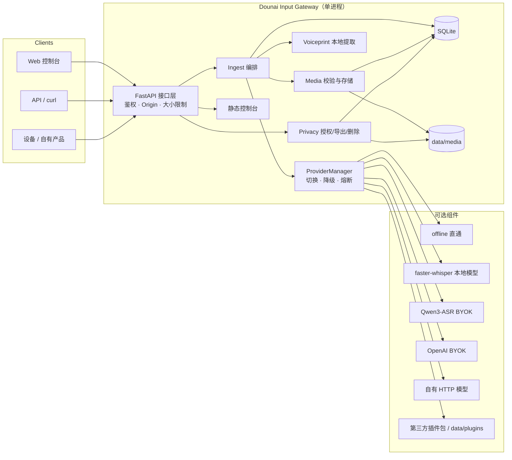
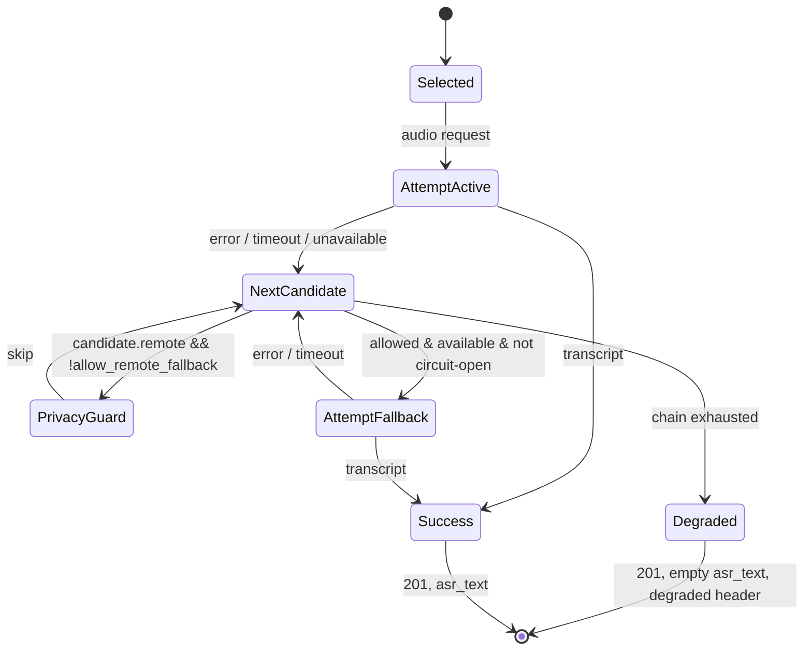

# 架构说明

## 1. 目标与非目标

**目标**

- 接收文字、图像、语音，完成校验、媒体存储、必要的语音转写与本地声纹判断；
- 输出一个稳定、严格、可被下游独立消费的事件；
- 用统一 provider 层屏蔽厂商协议差异，支持运行时切换与失败降级；
- 把生物特征与用户数据边界放在架构中心，而不是事后补丁；
- 可独立部署、演示、测试，不依赖其他业务模块。

**非目标**

- 不生成 AI 回复、不做情感分析或对话策略；这些属于下游；
- 不做多租户、账号体系、计费、设备配对和 OAuth；
- 不做生产级说话人识别/防伪；
- 不把图片内容理解强行塞进事件。事件携带图片引用，理解由下游模型完成；
- 不提供厂商账号或 API Key。

## 2. 总体结构



单进程是刻意的：隐私边界、SQLite 事务、媒体目录和声纹模板都在一个用户账户下，部署/备份/删除更容易解释。代价是不能水平扩展，见第 8 节。

## 3. 请求生命周期

以语音为例：

1. **HTTP 层**：Bearer 鉴权、Origin/Sec-Fetch-Site 校验、Content-Length 上限、请求 ID。
2. **Ingest**：规范化 `session_id`/`source`，读取音频字节并做魔数校验；不是只信 `Content-Type`。
3. **Media**：原子写入 `data/media/<uuid>.<ext>`，记录 SHA-256/mime/size；内容 URL 由 `public_base_url` 生成。
4. **Context**：从 `events` 查询该 session 最近 N 条文字/转写。
5. **ProviderManager**：active provider → fallback 链；每次尝试受超时、能力、隐私守卫、熔断控制。
6. **ASR**：成功得到文本；成功但空文本记为 `empty`，失败/无可用 provider 记为 `unavailable`，均不阻断事件。
7. **Voiceprint**：若开关、授权、模板齐全且是 WAV，本地提取、比较、结合唤醒词；任何异常降级为 `none`。
8. **Event**：构造版本化 Pydantic 模型（`metadata.asr_status`），写入 SQLite；响应头携带会话/降级/ASR 状态/模型信息。
9. **下游**：获得事件，按 `content` 拉取媒体（跨机用 base64 接口），按需消费 `asr_text`/`asr_status`/`voiceprint_event`/能力。

文字与图片不调用 provider 转写。文字已是最终内容；图片以引用交给下游。这样本层不需要擅自改写用户表达，也不会引入图片描述字段破坏契约。

## 4. 组件职责

| 组件 | 负责 | 不负责 |
| --- | --- | --- |
| `api.py` | 路由、鉴权、安全中间件、错误映射、静态资源 | 业务规则、模型调用 |
| `ingest.py` | 三模态校验、会话/来源规范化、转写和声纹编排 | HTTP、SQL |
| `media.py` | 魔数识别、大小限制、原子落盘、路径安全 | 图像内容理解 |
| `providers/base.py` | Provider 协议、能力/隐私声明、尝试轨迹 | 具体厂商协议 |
| `providers/registry.py` | 内置/entry point/目录插件发现 | 选择策略 |
| `providers/manager.py` | active、fallback、超时、熔断、隐私守卫 | 厂商 HTTP 细节 |
| `voiceprint.py` | 本地特征、模板、相似度、唤醒判断 | 生物特征上云 |
| `store.py` | SQLite、事件、媒体元数据、授权、审计、导出/删除 | 文件内容 |
| `privacy.py` | 政策、授权生命周期、ZIP 导出、保留期 | 身份认证 |
| `model_catalog.py` | 模型元数据、下载、校验、删除 | 运行时加载 |
| `web/` | 演示与人工操作界面 | 业务逻辑、模型调用 |

## 5. Provider 适配层

### 5.1 能力与角色

`ProviderManifest` 声明：

- `capabilities`：模型可接收的模态（text/image/audio）。这是给下游/运维的声明；
- `can_transcribe`：本层是否会把音频交给它并期待 `text`；
- `privacy`：`local` 或 `remote`。它决定降级守卫与 UI 提示；
- `requires_api_key`：是否 BYOK。

当前输入层只主动调用 `transcribe()`。文字/图片不经过模型，避免改变用户内容；`capabilities` 中 text/image 的意义是“该模型生态支持这些输入”，为后续下游选型和 UI 展示保留声明。新增能力（如 image caption）需要契约升级，不能偷偷塞进 metadata。

### 5.2 协议差异的收敛

`openai_compatible.py` 实现两种不同“OpenAI 兼容”：

| 协议 | 端点 | 典型厂商 |
| --- | --- | --- |
| `audio_transcriptions` | `POST /audio/transcriptions` multipart | OpenAI |
| `chat_audio` | `POST /chat/completions`，base64 `input_audio` | 阿里云 Qwen3-ASR |

Vendor 差异（字段、编码、错误码）只存在于 adapter；manager 只看到 `TranscriptionResult` 或 `ProviderError`。

### 5.3 切换与降级状态机



要点：

- 选择是**运行时**的，持久化到 `settings.active_provider`；
- provider 健康状态（熔断）只在内存，重启清空；
- 失败是**可观测但不致命**的：响应头、日志、管理端状态；
- 默认不允许任何非 active 的远程 provider 作为 fallback，云端降级必须显式开启；
- 切换时上下文不迁移 provider 状态，而是从持久化事件重新读取，避免厂商绑定。

### 5.4 插件发现

启动时：

1. 内置 provider（`offline`, `local-whisper`, `dashscope`, `openai`, `custom-http`）；
2. Python entry point 组 `dounai_input.providers`；
3. `data/plugins/*.py` 与 `DOUNAI_PLUGIN_PATH` 中模块级 `PROVIDER`。

插件失败只记录到 `plugin_errors`，不阻止服务启动。同 ID 冲突时先注册者获胜。插件代码在进程内执行，拥有完整权限，因此只安装可信包。

## 6. 数据模型

```text
events(event_id PK, timestamp, modality, content, asr_text, asr_status,
       voiceprint_event, model_capabilities, session_id, source,
       media_id, created_at)
media(id PK, path, filename, mime, size, sha256, event_id, created_at)
settings(key PK, value)
consents(id, granted, policy_version, recorded_at)
voiceprint_profiles(id=1, subject, embedding BLOB, dimension, samples, created_at)
privacy_audit(id, action, recorded_at, details_json)
```

设计考虑：

- **单文件 SQLite + WAL**：零运维、事务化删除/导出，适合单用户本地实例；
- **媒体文件不存 BLOB**：便于流式读取与清理；数据库只保存元数据和路径；
- **声纹模板只有一行**（单用户）：简化权限模型，明确“本机这个人”；
- **审计不含音频/文本/模板**：只记录动作、政策版本、计数；
- **保留期按 `created_at`**：媒体会跟随事件被清理，避免悬空引用；孤儿文件由启动/定时清理兜底。
- **schema v2**：`events.asr_status` 为显式转写状态；启动时自动为 v1 数据库补列并回填（非空音频文本 → completed，空音频 → unavailable，其余 → not_applicable）。迁移可重入。

## 7. 安全与隐私边界

- 声纹模板仅在 `voiceprint.py` 内产生，仅通过 `Store.save_voiceprint` 落入本地 SQLite；provider 接口没有 embedding 字段，从类型上就传不出去。
- 原始声纹样本只在内存中处理；使用临时上传对象后立即关闭，不进入 media 表。
- 音频/图像媒体以 128 位不可猜测 ID 作为能力 URL，便于下游消费；URL 本身是秘密。
- API Token 保护事件与控制接口；媒体 URL 是有意例外，部署文档要求保护日志/事件。
- 浏览器写请求做同源校验，阻断针对无 Token localhost 的 CSRF。
- 远程 provider 的 `privacy`、`requires_api_key`、`base_url` 在管理端可见；密钥不可见。
- 服务默认回环绑定；非回环未设 Token 拒绝启动。
- 保留期、删除、导出是**服务端**能力，不依赖前端。

威胁模型与残余风险见 [privacy.md](privacy.md)。

## 8. 可扩展性与限制

当前设计的边界：

- **单实例**：SQLite 和本地媒体目录不适合多副本并发写；如要横向扩展，需要外部数据库、对象存储、共享锁与集中式模型路由，属于重新设计。
- **同步转写**：请求等待 provider，最长 60 秒；高并发需要队列/异步回调，当前未实现。
- **声纹 CPU**：MFCC 计算在请求路径中 `to_thread`，大量并发会占用 CPU；本地模板是单用户。
- **无多租户**：没有用户账户，`session_id` 只是上下文分组，不是授权边界。
- **无热加载**：插件/模型安装在启动时发现，切换 provider 不重启，但新增 pip 包需要重启。
- **无流式 ASR**：一次完整音频请求；实时陪伴场景需要下游做流式改造。

这些限制在 README 和部署文档中明示，避免被误用为多租户 SaaS。

## 9. 关键取舍（ADR 摘要）

| 决策 | 选择 | 理由 | 代价 |
| --- | --- | --- | --- |
| 事件字段 | 版本化（v1.1 增加可选 `asr_status`），其他诊断放 header | 下游稳定；ASR 缺失不再静默 | 客户端需读 header 才能看会话/降级 |
| 模型角色 | 本层只做 ASR/能力声明 | 不篡改用户输入；契约无描述字段 | 多模态“理解”留给下游 |
| 本地模型 | 可选 extra + CLI 下载 | 核心轻量、权重不入库 | 首次安装额外步骤 |
| 声纹 | MFCC 统计基线 | 无重型依赖、可审计、完全本地 | 非生产级识别，噪声敏感 |
| 云端降级 | 默认关闭 | 防止音频意外出设备 | 可用性让位于隐私 |
| 存储 | SQLite + 文件 | 单文件、易删除/导出 | 不适合多副本 |
| 媒体访问 | 高熵能力 URL + 鉴权 base64 接口 | 同机 `/<audio>` 友好；跨机可取字节 | URL 泄露即数据泄露；base64 受 Token 保护 |
| 插件 | entry point + 本地文件 | 第三方可独立安装/卸载 | 进程内代码信任 |

## 10. 可观测性

- 标准库 logging，不记录正文、转写、音频或声纹。
- 日志字段：provider id、HTTP 状态类别、超时、降级、清理计数、请求 ID。
- `GET /healthz` 轻量；`GET /v1/providers` 提供能力/可用性/熔断状态。
- 响应头 `X-Request-ID` 用于把客户端问题与服务日志关联。
- 无内置指标/追踪/遥测。需要 Prometheus/OTel 的部署方可在反向代理或 fork 中接入；本项目刻意不外发数据。

## 11. 未来演进（不承诺）

- 契约 v1.2/v2：如需更多媒体元数据或显式 `schema_version`，需同步下游；当前 v1.1 已用 `x-contract-version` 暴露；
- 异步转写任务队列与 webhook；
- 可选 SQLite 加密/操作系统钥匙串保护；
- 更可靠的声纹模型（独立可选包），但必须保持本地；
- 多设备独立 Token 与来源策略；
- provider 健康探测与指标导出。

任何演进都不得破坏“声纹不出设备”和事件契约的稳定性。
