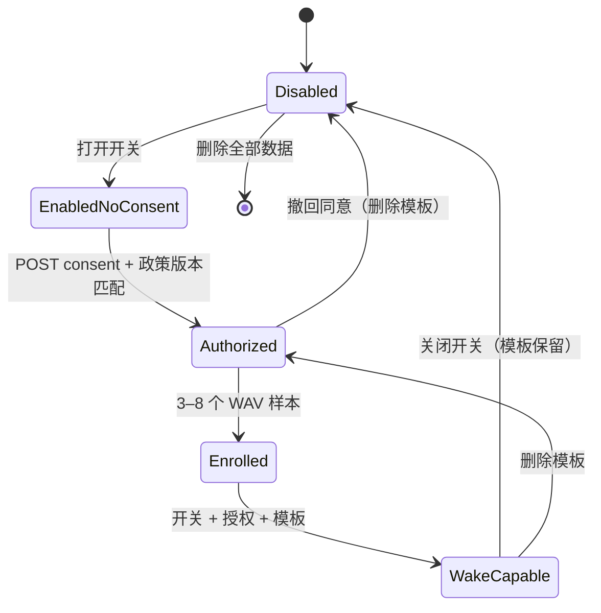

# 隐私与安全设计

隐私不是本项目的“合规附录”，而是会影响架构选择的硬约束。本文说明数据流、边界、控制、残余风险与运维要求。它不是法律意见；上线前应由产品方根据所在地法律和用户群体完成评估。

## 1. 原则

1. **本地优先**：声纹提取、声纹模板存储、唤醒判断全部在本机完成。
2. **数据最小化**：没有输入就没有数据；不采集通讯录、位置、设备指纹、广告标识或行为遥测。
3. **明确授权**：声纹默认关闭；只有用户看到政策文本并主动授权后才可能工作。
4. **可撤回、可删除、可导出**：用户不需要联系客服或修改数据库。
5. **默认不跨云降级**：本地模型失败时不会擅自把音频发给第三方。
6. **失败不扩权**：模型/网络故障不得导致数据被发到未选择的厂商，也不得阻止用户输入被记录。
7. **凭据最小化**：用户自备的厂商 API Key 只以密文保存在本机；不写入配置或环境变量，不进入日志、导出、错误信息或界面回显，界面只显示不可逆指纹。

## 2. 数据清单

| 数据 | 位置 | 目的 | 默认保留 | 是否出设备 |
| --- | --- | --- | --- | --- |
| 文字内容 | SQLite `events.content` | 交给下游 | 72 小时 | 否（除云端转写时可能作为上下文片段发送，见 3.3；本层不把文字发给模型） |
| 图像文件 | `data/media/` | 交给下游 | 72 小时 | 否（本层不调用图像理解） |
| 音频文件 | `data/media/` | 交给下游；可选转写 | 72 小时 | 仅当用户选择云端/API 转写模型时发给该连接指向的服务 |
| 语音转写 | SQLite `events.asr_text` + `asr_status` | 下游 + 会话上下文 | 72 小时 | 否（若由云端生成，文本已回到本地） |
| 会话 ID / 来源 | SQLite `events` | 上下文分组、设备排障 | 72 小时 | 否 |
| 声纹模板 | SQLite BLOB，80 维 float32 | 唤醒判断 | 直到删除/撤回 | **否，永不** |
| 授权记录 | SQLite `consents` | 证明授权时间/版本 | 直到删除 | 否 |
| 隐私审计 | SQLite `privacy_audit` | 证明开关/删除/导出操作 | 直到删除 | 否 |
| provider 选择 | SQLite `settings` | 重启后恢复 | 直到删除数据 | 否 |
| API 连接（名称、Base URL、HTTP/私网权限） | SQLite `api_connections`，不含密钥明文 | 重建 provider、展示来源 | 直到删除连接 | 否 |
| 厂商 API Key | SQLite `api_connections` 中的 AES-256-GCM 密文 + nonce | 以用户身份调用所填厂商 | 直到删除连接/轮换密钥 | 仅随请求发给该连接的厂商 |
| 主密钥 | `data/.secret.key`（0600）或操作系统钥匙串 | 加解密 API Key | 直到删除最后一个连接/删除全部数据 | **否，永不出设备** |
| 模型探测结论（能力、延迟、转写协议） | SQLite `api_models` | 决定是否可转写及降级顺序 | 直到删除模型/连接 | 否 |
| API 请求日志（如启用） | stdout/文件，由部署方管理 | 运维 | 部署方决定 | 否（本层日志不含正文/音频） |
| 模型权重 | `data/models/` | 离线推理 | 直到卸载 | 否 |

**不存在**：账号、密码、手机号、通讯录、精确位置、设备唯一标识、广告 ID、遥测事件、崩溃上报、第三方分析 SDK、Cookie。厂商账户密码也不存在：用户只粘贴自己生成的 API Key，本层保存的是该 Key 的密文。

## 3. 数据流

### 3.1 文字 / 图像

```text
浏览器/API → 校验 → SQLite（文字）或 media 文件（图像）→ 事件
```

本层不调用云端模型处理文字/图像，因此文字/图像不出设备；即使当前选中了云端 API 模型，输入层也只保存事件。`model_capabilities` 仅声明当前选中模型能力；本层不会因为选了 Qwen 就把图片发过去。下游若需要图片理解，必须自行按事件引用读取并遵守其数据政策。

### 3.2 语音 + 本地模型

```text
音频 → 本地 media → faster-whisper（本机）→ asr_text → 本地 SQLite
                     └→ 声纹（本机内存）→ wakeup/none
```

音频与声纹均不出设备。

### 3.3 语音 + 云端模型

```text
音频 → 本地 media（短期）→ HTTPS（默认）→ 用户建立的 API 连接（转写）→ asr_text → 本地
                              └→ 声纹仍在本机独立计算，模板不发送
```

这是用户显式切换/选择云端 provider 后发生的数据流。云端 provider 不是内置厂商配置，而是用户在控制台建立的 **API 连接**：用户填写 OpenAI 兼容的 Base URL 与自己的 API Key，服务端据此调用。它可以是官方 API、聚合网关，也可以是用户自建的内网服务。

- 只有音频事件会触发转写调用；文字、图像、历史媒体不会随请求发送。
- 若该模型使用 `audio_transcriptions` 协议，为提升识别准确度，请求会附带同一会话最近 `session_context_events`（默认 3）条文字/转写内容中末尾不超过 400 字符的文本作为 `prompt`；`chat_audio` 协议不发送该上下文。把 `[processing].session_context_events` 设为 `0` 可关闭上下文，同时也会让本地转写失去上下文。
- Base URL 默认只允许 HTTPS；私网/回环地址与明文 HTTP 需要用户在连接上显式勾选放行，云元数据地址始终拒绝，且不跟随重定向。详见 5.3。
- 能力探测只发送合成数据：一条极短文本、1×1 PNG、0.8 秒合成正弦波 WAV；不会发送用户事件、媒体、声纹或历史会话，但会携带用户的 API Key 访问用户填写的地址，并可能产生极少量厂商调用费用。

Web 控制台在切换远程模型时弹窗说明；API 客户端应自行向用户披露。`privacy` 字段和 provider 列表可以帮助产品实现提示。

### 3.4 API 连接建立与探测

```text
用户输入 Base URL + API Key
  → 校验 URL（HTTPS/私网/HTTP 策略、DNS、元数据地址）
  → GET {base_url}/models 发现模型
  → 对勾选模型逐项探测 text / image / audio（合成数据）
  → API Key 加密入库；探测结论入库并派生 provider
```

- “发现”只读模型列表，不保存任何内容；密钥错误返回 422 `api_auth_failed`。
- “探测”结果是黑盒 HTTP 结论，不是厂商能力担保；厂商随时可能变更模型或协议。
- 保存连接时，密钥以 AES-256-GCM 加密后写入本机 SQLite；响应只返回不可逆指纹。
- 每个保存的模型会成为一个 `remote` provider，可像内置 provider 一样切换；它不是“默认降级候选”。

### 3.5 降级

默认链路只会：

- 从云端 active → 本地 fallback；
- 从本地 active → 本地 fallback；
- 不会从本地 active → 云端 fallback；
- 不会从云端 active → 另一家云端 fallback。

API 连接派生的云端 provider **不会**被自动加入 fallback 链；只有当前 active 的连接模型会被尝试，失败后按 `[models].fallback`（默认仅 `local-whisper`）回退。即使管理员把某个远程 provider 写进 fallback，只有显式设置 `allow_remote_fallback=true` 才会尝试它。删除当前使用的 API 连接或模型时，会立即切回 `offline`（或配置的本地 fallback）。该开关不改变声纹模板“永不出设备”的保证。

## 4. 声纹授权状态机



只有 `WakeCapable` 才可能输出 `voiceprint_event: "wakeup"`。详细条件：

1. `voiceprint_enabled` 为 true；
2. 最新授权 granted 且政策版本与当前一致；
3. 存在模板；
4. WAV 可解码，语音比例足够；
5. 余弦相似度 ≥ 阈值（默认 0.82）；
6. 若 `wake_phrase_required=true`，转写文本规范化后包含唤醒词。

任一失败返回 `none`，音频事件仍然生成。

## 5. 技术控制

### 5.1 声纹数据隔离

- `BaseProvider`/`TranscriptionRequest` 没有声纹字段；声纹代码不导入 provider 模块；从接口上无法把模板传给厂商。
- 原始样本只在 `PrivacyService.enroll` 的请求内存中存在；不写 media，不写临时文件。
- 模板只由 `Store.save_voiceprint` 写入本地 SQLite；查询只给 `VoiceprintService`。
- 正常 API 不返回模板、相似度或原始样本。导出是用户主动请求的显式例外。
- 日志不记录特征、相似度、模板或原始音频。

### 5.2 存储与文件

- 数据目录、媒体目录默认 `0700`；数据库 `0600`（POSIX 生效）。
- Windows 上 `chmod` 不等价于 ACL；请使用受密码保护的操作系统账户，并确保 `data/` 不在共享目录。
- 媒体文件名由服务生成 UUID，原始文件名仅作展示；不复用用户文件名作为路径。
- 路径解析后必须落在 media 根目录内，防止目录穿越。
- 上传按魔数校验，SVG 不接受，避免脚本注入与伪装文件。
- 删除事件时会同步删除关联媒体；保留期任务按事件引用清理，避免悬空。
- 主密钥文件 `data/.secret.key` 以 `0600` 独占创建；它只保护“数据库或整个数据目录被单独拷走”的场景，获得该文件与数据库的人可以解密 API Key。启用 `keyring` 时主密钥移入操作系统凭据存储，数据目录不再保留副本。
- 厂商 API Key 只以“密文 + 随机 nonce”形式存放在 SQLite，不写 media、不写临时文件、不写配置文件。
- 备份或整机迁移如果同时包含 `data/dounai.sqlite3` 与 `data/.secret.key`，等价于备份了可解密的厂商密钥；启用 keyring 时则需单独处理钥匙串条目（其名称绑定数据目录的绝对路径）。

### 5.3 网络

- 默认只绑定 `127.0.0.1`。
- 绑定非回环地址必须设置 `DOUNAI_API_TOKEN`，否则启动失败。
- 所有业务接口 Bearer 鉴权；比较使用常量时间。
- 浏览器 `POST/PUT/PATCH/DELETE` 校验 `Origin` 与 `Sec-Fetch-Site`，阻止 CSRF。
- 不启用 CORS；控制台与 API 同源。
- 媒体能力 URL 使用 128 位随机 ID；持有 URL 即可读取，需按秘密管理。跨机消费应使用需 Token 的 `/v1/media/{id}/base64` 或 `/v1/events/{id}/media`，避免依赖公开 URL。
- 出站第三方调用只针对用户显式填写的 API 连接地址（发现、探测、转写），不会扫描或连接其他地址；若部署环境设置了 `HTTPS_PROXY`/`HTTP_PROXY` 等变量，httpx 会按这些变量选择代理。
- 厂商 Base URL 默认必须是 HTTPS；`http` 需要用户在连接上显式允许 `allow_http`，私网/回环/链路本地地址需要显式允许 `allow_private`。云元数据地址（169.254.169.254、metadata.google.internal 等）无条件拒绝，IPv4-mapped IPv6 同样检查。
- 域名会先解析，所有解析结果都必须满足“公网”规则；请求不跟随重定向，避免 30x 把密钥带到未校验地址。
- 残留风险：校验与真正发起请求之间存在 DNS rebinding 的 TOCTOU 窗口；本层通过“不跟随重定向 + 每次出站前重新校验 URL 策略”缩小影响，但不承诺完全消除。高敏感环境应在网络层做 egress allowlist。
- 列表/详情等读操作不触发出站；刷新与重新探测会先做语法/策略校验，再解析域名并发起请求。
- 无遥测，不主动连接除用户配置的 provider / API 连接之外的地址。

### 5.4 密钥

**网关自身的 Token**：`DOUNAI_API_TOKEN` 只从环境变量读取，不写入数据库或配置文件；日志/异常/API 不回显；轮换后重启即生效。`custom-http` provider 的 token 同样通过 `token_env` 指向的环境变量读取。

**厂商 API Key（BYOK）**：

- 用户在控制台或 `POST /v1/api-connections` 中粘贴 Key；服务端用 `SecretStore` 以 AES-256-GCM 加密，nonce 每次随机，AAD 绑定用途 `api-connection`。SQLite 只保存密文、nonce 与不可逆指纹（SHA-256 摘要的 base64 前 10 个字符）。
- 主密钥为 256 位随机数，经 HKDF-SHA256 按用途派生加密密钥。默认保存在 `data/.secret.key`（独占创建，`0600`）；安装可选依赖 `pip install ".[keyring]"` 并设置 `DOUNAI_SECRET_BACKEND=keyring` 后改存操作系统凭据存储（Windows Credential Manager / macOS Keychain / Linux Secret Service）。
- `DOUNAI_SECRET_BACKEND` 支持 `auto`（默认：keyring 可用则用，否则文件）、`file`、`keyring`。`auto` 在 keyring 读失败时降级到文件；由 keyring 切换到文件时会尝试把主密钥迁回 `data/.secret.key`，反之亦然，避免已有密文失效。
- 明文 Key 只在创建/更新连接、以及派生 provider 时于进程内存中短暂出现；进程运行期间 provider 实例会持有明文 Key 以发起请求。它不会进入响应、导出、日志、错误消息或前端。控制台在关闭对话框时清空输入框。
- 密钥轮换：`PATCH /v1/api-connections/{id}` 只提交新 `api_key` 即可，旧密文被覆盖；无需重启。若数据库中的密文无法解密（主密钥丢失/被替换），该连接会拒绝工作并提示重新保存 Key，而不是回退到匿名请求。
- 主密钥销毁：删除最后一个 API 连接或执行“删除全部个人数据”时，服务会同时删除 `data/.secret.key` 与当前数据目录对应的 keyring 条目。仅删除单个连接时，其密文随连接删除。
- 主密钥与数据库同机存放（除非启用 keyring）。同一操作系统账户下的恶意进程、内存转储或同时拿到 `data/` 与 `.secret.key` 的备份，都可以解密厂商 Key；这是本机信任模型的边界。
- 换机/迁移：文件后端随 `data/.secret.key` 一起迁移即可；keyring 条目名称由数据目录绝对路径派生，移动目录或换机后需要重新保存 Key，或把旧条目迁移到新路径。
- 测试覆盖：明文不落库、随机 nonce、主密钥轮换后解密失败、keyring 迁移/回退、删除主密钥同时清理文件与 keyring、连接接口不回显 Key。

### 5.5 保留与删除

- 默认 72 小时保留事件与媒体；可配置。
- 启动后与每 15 分钟运行清理（首个清理延迟 2 秒）。
- 声纹模板、授权、审计不按时间自动删除，需用户操作；这是为了不让“授权证据”意外消失。
- `DELETE /v1/privacy/data?confirm=true` 删除事件、媒体、声纹模板、API 连接及其密钥密文、授权、审计，随后写一条无个人内容的删除操作记录；若已无 API 连接，主密钥文件/keyring 条目一并删除。
- 删除单个 API 连接会删除其下全部模型与密钥密文；如果它正是当前 provider，会立即切回 `offline`（或配置的本地 fallback）。删除最后一个连接也会删除主密钥。
- 导出包包含事件、媒体、声纹与 API 连接的**元数据**（名称、Base URL、模型标识与能力、不可逆指纹），但绝不含 API Key 明文、密文、nonce 或主密钥。
- 删除是物理删除，不是软删除；SQLite/WAL 文件可能仍保留已释放页，文件系统/SSD 也可能保留副本，备份/取证层面不能保证不可恢复。`unlink` 主密钥同样不等于安全擦除。高敏感场景应使用全盘加密与安全擦除策略。

### 5.6 日志

- 应用日志不记录正文、转写、音频、声纹模板/相似度、API Key 或请求头。
- API 连接相关日志只使用连接 id / provider id、HTTP 状态码与异常类型；不打印厂商响应正文、Authorization 头、密文或主密钥。探测失败也只返回经过净化的提示。
- CLI 默认关闭 Uvicorn 访问日志；`--access-log` 显式开启。访问日志包含请求路径，媒体路径中含能力 URL，应按敏感日志管理。
- 反向代理的访问日志也可能记录 IP、路径和媒体 ID；部署方应关闭或缩短保留。
- `X-Request-ID` 仅用于关联请求，不含用户内容。

## 6. 威胁模型

| 威胁 | 影响 | 控制 | 残余风险 |
| --- | --- | --- | --- |
| 恶意网站向 localhost 提交音频 | 未经授权的数据/费用 | Origin / Sec-Fetch-Site；默认本机；Token | 非浏览器本地进程可绕过 Origin；需操作系统账户边界 |
| 攻击者读取 `data/` | 事件、媒体、声纹、API Key 密文泄漏 | 权限收紧；API Key 加密；默认本机；无云同步 | 同时拿到数据库与 `.secret.key` 即可解密明文；同账户恶意软件/管理员可读 |
| 媒体 URL 泄漏 | 单个媒体被读取 | 128 位随机 ID；不公开；日志避免记录 URL | 拿到 URL 的人可读；无法撤销单 URL（删除事件/媒体可失效） |
| API Token 泄漏 | 全部 API 可访问 | 高熵 Token；HTTPS；轮换 | 无速率限制、无 IP 绑定、单 Token |
| 恶意/被篡改的 Base URL（SSRF） | 内网探测、云元数据读取、密钥外送 | 仅 http(s)；默认拒绝私网/回环/HTTP；元数据地址硬拒绝；解析全部 DNS 结果；不跟随重定向 | 校验与请求之间的 DNS rebinding TOCTOU；需网络层 egress allowlist |
| 厂商 API Key 被本机窃取 | 以用户账号调用厂商、产生费用 | AES-256-GCM；主密钥 0600 或 keyring；日志/导出/响应不回显 | 同账户进程、内存转储、含密钥文件的备份；无 HSM |
| 冒充厂商端点 | 用户音频与 Key 被第三方获取 | 默认 HTTPS 并校验系统信任链；用户显式填 URL | 用户可主动填写恶意/错误 URL；没有证书固定 |
| 云端厂商泄露音频/训练模型 | 语音与上下文泄露 | 用户显式建立连接并切换；本地模型可选；文档披露 | 厂商侧不可控；需自行评估其条款与账户设置 |
| 云端转写附带会话上下文 | 近期文字被一并发送 | 默认仅末尾 ≤400 字符；`session_context_events=0` 可关闭；文档披露 | `chat_audio` 不发上下文，`audio_transcriptions` 会发；下游需告知用户 |
| 声纹被录音重放/合成语音欺骗 | 误触发 wakeup | 唤醒词 + 阈值；产品层不应把 wakeup 当身份认证 | 基线模型无 anti-spoofing |
| 模型供应商返回恶意/超长文本 | 下游注入/资源消耗 | 只取文本字段；JSON 校验；不执行内容 | 文本内容未做安全过滤，属于下游职责 |
| 插件供应链攻击 | 任意代码执行 | 只安装可信插件；核心不自动加载远程代码 | 插件运行在进程内，拥有完整权限 |
| 删除后从备份恢复 | 用户以为已删除 | 文档说明备份策略由部署方负责 | 本项目不管理备份 |
| 资源耗尽（大文件/并发） | 服务不可用 | 大小限制、超时、熔断 | 无全局限流；单实例 CPU/磁盘可能被打满 |

## 7. 明确的非保证

- **不是匿名化**：文字、语音、图像本身可能包含个人信息。
- **不是端到端加密**：数据库和媒体是本地明文文件；传输到云端使用 HTTPS，但厂商可见明文音频；转写请求还可能带上最近会话文本片段。
- **不是身份认证**：声纹仅用于唤醒体验，不能用于登录、支付、门禁、权限。
- **不是合规认证**：仓库提供技术控制与文档，不替代 GDPR/个人信息保护法/儿童隐私等法律评估。
- **不保证删除不可恢复**：文件系统、备份、SSD 磨损均衡都可能保留副本；高敏感部署需全盘加密和密钥销毁。
- **不保证厂商不训练**：第三方 API 的数据使用取决于厂商条款和账户设置，本层无法控制。
- **不是密钥托管或 HSM**：主密钥与数据库同机（除非启用 keyring），没有远程托管、恢复或硬件隔离；主密钥丢失意味着保存的 Key 无法解密，需要重新填写。
- **不担保厂商能力声明**：能力探测只是保存时刻的黑盒 HTTP 结论，厂商可以随时改变模型、协议、限流或数据政策；“OpenAI 兼容”也不代表只接收最小字段。
- **不是网络隔离**：本层不做 egress 防火墙或 DNS pinning；需要强隔离时应由容器网络、代理或主机防火墙限制可访问的厂商域名。

## 8. 用户权利与操作映射

| 权利 | Web | API | CLI |
| --- | --- | --- | --- |
| 知情 | 隐私面板、政策弹窗 | `GET /v1/privacy/policy` | `privacy status` |
| 同意 | 勾选 + 授权 | `POST /v1/privacy/consent` | `privacy consent --accept` |
| 关闭 | 开关 | `PUT /v1/privacy/settings` | `privacy enable/disable` |
| 撤回 | 撤回按钮 | `DELETE /v1/privacy/consent` | `privacy withdraw` |
| 删除模板 | 删除按钮 | `DELETE /v1/privacy/voiceprint` | `privacy delete-voiceprint` |
| 删除 API 连接与密钥 | API 接入卡片的删除按钮 | `DELETE /v1/api-connections/{id}` | 无 CLI 命令 |
| 导出 | 导出按钮 | `GET /v1/privacy/export` | `data export --output` |
| 删除全部 | 删除对话框 | `DELETE ...?confirm=true` | `data delete --yes` |
| 查看状态 | 状态 chips | `GET /v1/privacy/status` | `privacy status` |

导出文件包含生物特征，必须提示用户妥善保管；控制台会显示提示。导出包里的 API 连接只有元数据与不可逆指纹，不含密钥明文、密文或主密钥。

## 9. 部署方责任

- 使用 HTTPS 反向代理，保护 API Token 与媒体 URL。
- 使用专用操作系统账户，限制 `data/` 权限，启用磁盘加密。
- 不把 `data/` 放进 Git、网盘同步或共享目录。
- 配置合理的保留期；定期验证清理和删除。
- API 连接由最终用户在控制台建立；不要在 `.env`、TOML、镜像或部署脚本中预置厂商密钥。
- 保护 `data/.secret.key` 与 keyring 条目：它们和数据库同等级敏感；备份必须加密，恢复时确认主密钥与数据库来自同一份快照。
- 为出站流量设置 allowlist（至少覆盖用户实际使用的厂商域名与代理）；本层不提供网络隔离。
- 容器/无桌面环境通常没有 Secret Service，`DOUNAI_SECRET_BACKEND=auto` 会回落到文件后端；若强制 keyring，需要额外提供 D-Bus/凭据服务。
- 对第三方 provider 做隐私/合规评估，向用户披露音频会发给谁，以及 `audio_transcriptions` 会附带最近会话文本片段。
- 若面向儿童或敏感人群，先完成额外法律与安全评估。
- 若修改声纹/唤醒逻辑，保持本地性并更新政策版本与测试。

## 10. 事件响应

1. **怀疑厂商 API Key 泄漏**：立即在厂商控制台吊销/轮换；在控制台或 `PATCH /v1/api-connections/{id}` 保存新 Key（旧密文会被覆盖），或删除该连接；检查厂商侧异常调用记录。不需要重启服务，也不存在需要清理的环境变量。
2. **怀疑数据目录泄漏**：停止服务；保留证据；轮换 API Token；评估媒体/声纹/API Key 暴露；删除或轮换受影响的 API 连接并销毁主密钥（删除最后一个连接或“删除全部个人数据”）；按适用法律通知用户。
3. **怀疑插件恶意**：卸载插件/删除 `data/plugins`；重建环境；检查外连与数据目录。
4. **误发云端**：确认 active provider、`allow_remote_fallback` 与 `[models].fallback`；联系厂商按条款删除；向用户披露，包括随转写发送的会话上下文。
5. **删除请求**：优先通过 API/CLI 执行；如数据库损坏，手动删除 `data/` 下全部文件并书面记录，注意备份。
6. **主密钥丢失或 keyring 不可用**：保存的密钥将无法解密，对应 provider 会被禁用并提示重新保存 Key；重新填写 Key 即可恢复，不需要重建数据库。换机或移动数据目录后 keyring 条目不会自动跟随，需按 5.4 处理。

## 11. 安全测试建议

- 复现 `tests/test_auth.py` 的 Origin/Token 用例；
- 复现 `tests/test_api_connections.py`：明文不落库、随机 nonce、密钥轮换、keyring 迁移与回退、删除主密钥、SSRF/元数据/重定向用例；
- 用自定义 `resolver`/mock transport 验证“解析到私网但 URL 是公网域名”的绕过路径，并确认请求不跟随重定向；
- 检查日志是否出现密钥、转写、URL、模板、厂商响应正文；
- 用错误/恶意 provider 响应测试降级与错误回显；
- 抓包确认探测请求只包含合成文本/PNG/WAV，转写请求只包含当前音频与允许的上下文片段；
- 检查导出 ZIP 的路径与内容，确认不含 API Key 明文或密文；
- 在目标操作系统上验证 `data/` 与 `.secret.key` 权限，以及 keyring 条目的实际位置；
- 对声纹做真实录音的误接受/误拒绝评估，不要只用合成音；
- 评估录音重放与 TTS 攻击，明确产品中 `wakeup` 的权限边界。
