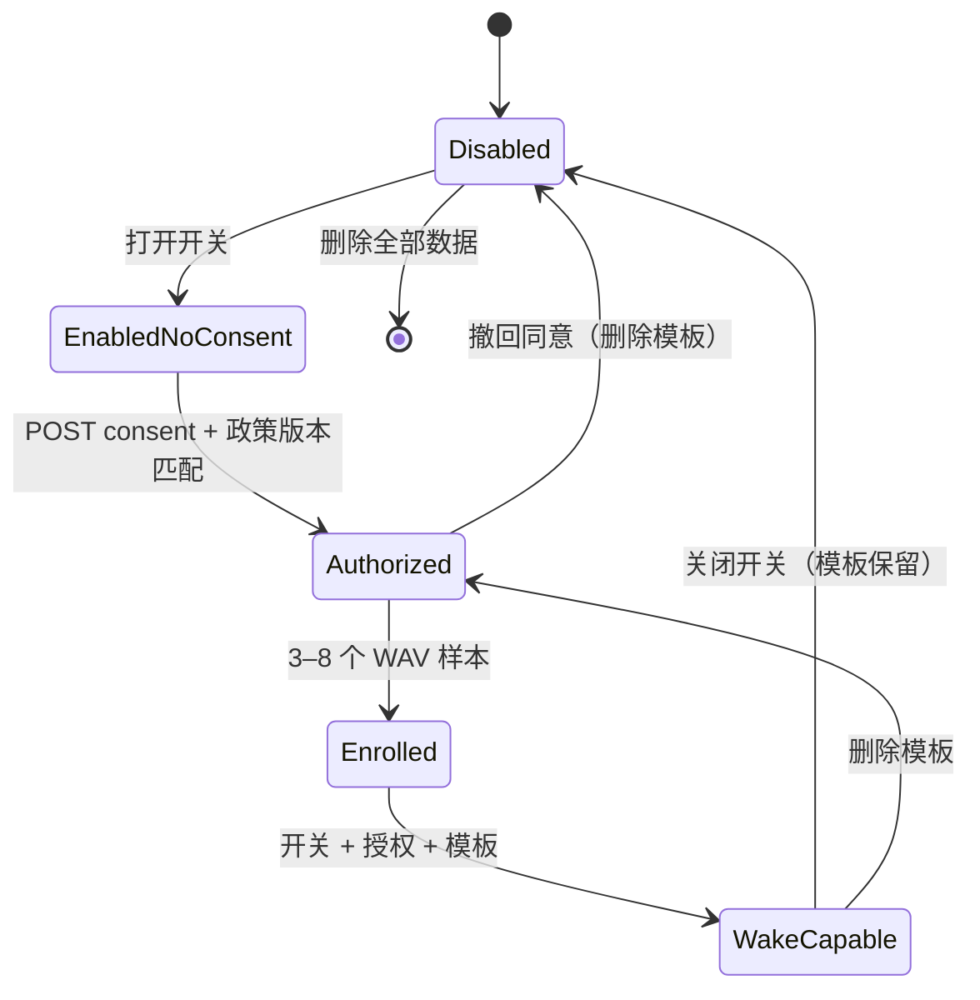

# 隐私与安全设计

隐私不是本项目的“合规附录”，而是会影响架构选择的硬约束。本文说明数据流、边界、控制、残余风险与运维要求。它不是法律意见；上线前应由产品方根据所在地法律和用户群体完成评估。

## 1. 原则

1. **本地优先**：声纹提取、声纹模板存储、唤醒判断全部在本机完成。
2. **数据最小化**：没有输入就没有数据；不采集通讯录、位置、设备指纹、广告标识或行为遥测。
3. **明确授权**：声纹默认关闭；只有用户看到政策文本并主动授权后才可能工作。
4. **可撤回、可删除、可导出**：用户不需要联系客服或修改数据库。
5. **默认不跨云降级**：本地模型失败时不会擅自把音频发给第三方。
6. **失败不扩权**：模型/网络故障不得导致数据被发到未选择的厂商，也不得阻止用户输入被记录。

## 2. 数据清单

| 数据 | 位置 | 目的 | 默认保留 | 是否出设备 |
| --- | --- | --- | --- | --- |
| 文字内容 | SQLite `events.content` | 交给下游 | 72 小时 | 否（本层不回传云端；除非下游另行处理） |
| 图像文件 | `data/media/` | 交给下游 | 72 小时 | 否（本层不调用图像理解） |
| 音频文件 | `data/media/` | 交给下游；可选转写 | 72 小时 | 仅当用户选择云端 ASR 时发给该厂商 |
| 语音转写 | SQLite `events.asr_text` | 下游 + 会话上下文 | 72 小时 | 否（若由云端生成，文本已回到本地） |
| 会话 ID / 来源 | SQLite `events` | 上下文分组、设备排障 | 72 小时 | 否 |
| 声纹模板 | SQLite BLOB，80 维 float32 | 唤醒判断 | 直到删除/撤回 | **否，永不** |
| 授权记录 | SQLite `consents` | 证明授权时间/版本 | 直到删除 | 否 |
| 隐私审计 | SQLite `privacy_audit` | 证明开关/删除/导出操作 | 直到删除 | 否 |
| provider 选择 | SQLite `settings` | 重启后恢复 | 直到删除数据 | 否 |
| API 请求日志（如启用） | stdout/文件，由部署方管理 | 运维 | 部署方决定 | 否（本层日志不含正文/音频） |
| 模型权重 | `data/models/` | 离线推理 | 直到卸载 | 否 |

**不存在**：账号、密码、手机号、通讯录、精确位置、设备唯一标识、广告 ID、遥测事件、崩溃上报、第三方分析 SDK、Cookie。

## 3. 数据流

### 3.1 文字 / 图像

```text
浏览器/API → 校验 → SQLite（文字）或 media 文件（图像）→ 事件
```

本层不调用云端模型，因此文字/图像不出设备。`model_capabilities` 仅声明当前选中模型能力；本层不会因为选了 Qwen 就把图片发过去。下游若需要图片理解，必须自行按事件引用读取并遵守其数据政策。

### 3.2 语音 + 本地模型

```text
音频 → 本地 media → faster-whisper（本机）→ asr_text → 本地 SQLite
                     └→ 声纹（本机内存）→ wakeup/none
```

音频与声纹均不出设备。

### 3.3 语音 + 云端模型

```text
音频 → 本地 media（短期）→ HTTPS → 用户选择的厂商（转写）→ asr_text → 本地
                              └→ 声纹仍在本机独立计算，模板不发送
```

这是用户显式切换/选择云端 provider 后发生的数据流。Web 控制台在切换远程模型时弹窗说明；API 客户端应自行向用户披露。`privacy` 字段和 provider 列表可以帮助产品实现提示。

### 3.4 降级

默认链路只会：

- 从云端 active → 本地 fallback；
- 从本地 active → 本地 fallback；
- 不会从本地 active → 云端 fallback；
- 不会从云端 active → 另一家云端 fallback。

要允许远程 fallback，必须设置 `allow_remote_fallback=true`，并重新评估用户告知。该开关不改变声纹模板“永不出设备”的保证。

## 4. 声纹授权状态机



只有 `WakeCapable` 才可能输出 `voiceprint_event: "wakeup"`。详细条件：

1. `voiceprint_enabled` 为 true；
2. 最新授权 granted 且政策版本与当前一致；
3. 存在模板；
4. WAV 可解码，语音比例足够；
5. 余弦相似度 ≥ 阈值（默认 0.82）；
6. 若 `wake_phrase_required=true`，转写文本规范化后包含唤醒词。

任一失败返回 `none`，音频事件仍然生成。

## 5. 技术控制

### 5.1 声纹数据隔离

- `BaseProvider`/`TranscriptionRequest` 没有声纹字段；声纹代码不导入 provider 模块；从接口上无法把模板传给厂商。
- 原始样本只在 `PrivacyService.enroll` 的请求内存中存在；不写 media，不写临时文件。
- 模板只由 `Store.save_voiceprint` 写入本地 SQLite；查询只给 `VoiceprintService`。
- 正常 API 不返回模板、相似度或原始样本。导出是用户主动请求的显式例外。
- 日志不记录特征、相似度、模板或原始音频。

### 5.2 存储与文件

- 数据目录、媒体目录默认 `0700`；数据库 `0600`（POSIX 生效）。
- Windows 上 `chmod` 不等价于 ACL；请使用受密码保护的操作系统账户，并确保 `data/` 不在共享目录。
- 媒体文件名由服务生成 UUID，原始文件名仅作展示；不复用用户文件名作为路径。
- 路径解析后必须落在 media 根目录内，防止目录穿越。
- 上传按魔数校验，SVG 不接受，避免脚本注入与伪装文件。
- 删除事件时会同步删除关联媒体；保留期任务按事件引用清理，避免悬空。

### 5.3 网络

- 默认只绑定 `127.0.0.1`。
- 绑定非回环地址必须设置 `DOUNAI_API_TOKEN`，否则启动失败。
- 所有业务接口 Bearer 鉴权；比较使用常量时间。
- 浏览器 `POST/PUT/PATCH/DELETE` 校验 `Origin` 与 `Sec-Fetch-Site`，阻止 CSRF。
- 不启用 CORS；控制台与 API 同源。
- 媒体能力 URL 使用 128 位随机 ID；持有 URL 即可读取，需按秘密管理。
- 第三方调用使用 HTTPS（配置允许 http 以支持本地自建服务，但生产应使用 HTTPS 或内网隔离）。
- 无遥测，不主动连接除用户配置的 provider 之外的地址。

### 5.4 密钥

- 密钥只存在于进程环境变量。
- 配置只保存变量名（`api_key_env`/`token_env`）。
- 不在日志/异常/API/前端中回显；测试明确检查这一点。
- 日志不记录请求头。
- 轮换密钥只需重启服务。

### 5.5 保留与删除

- 默认 72 小时保留事件与媒体；可配置。
- 启动后与每 15 分钟运行清理（首个清理延迟 2 秒）。
- 声纹模板、授权、审计不按时间自动删除，需用户操作；这是为了不让“授权证据”意外消失。
- `DELETE /v1/privacy/data?confirm=true` 删除事件、媒体、模板、授权、审计，随后写一条无个人内容的删除操作记录。
- 删除是物理删除，不是软删除；SQLite/WAL 文件可能仍保留已释放页，备份/取证层面不能保证不可恢复。高敏感场景应使用全盘加密与安全擦除策略。

### 5.6 日志

- 应用日志不记录正文、转写、音频、声纹模板/相似度、API Key 或请求头。
- CLI 默认关闭 Uvicorn 访问日志；`--access-log` 显式开启。访问日志包含请求路径，媒体路径中含能力 URL，应按敏感日志管理。
- 反向代理的访问日志也可能记录 IP、路径和媒体 ID；部署方应关闭或缩短保留。
- `X-Request-ID` 仅用于关联请求，不含用户内容。

## 6. 威胁模型

| 威胁 | 影响 | 控制 | 残余风险 |
| --- | --- | --- | --- |
| 恶意网站向 localhost 提交音频 | 未经授权的数据/费用 | Origin / Sec-Fetch-Site；默认本机；Token | 非浏览器本地进程可绕过 Origin；需操作系统账户边界 |
| 攻击者读取 `data/` | 事件、媒体、声纹泄漏 | 权限收紧；默认本机；无云同步 | 同账户恶意软件/管理员可读 |
| 媒体 URL 泄漏 | 单个媒体被读取 | 128 位随机 ID；不公开；日志避免记录 URL | 拿到 URL 的人可读；无法撤销单 URL（删除事件/媒体可失效） |
| API Token 泄漏 | 全部 API 可访问 | 高熵 Token；HTTPS；轮换 | 无速率限制、无 IP 绑定、单 Token |
| 云端厂商泄露音频 | 语音内容泄露 | 用户显式选择；本地模型可选；文档披露 | 厂商侧不可控；需自行评估其条款 |
| 声纹被录音重放/合成语音欺骗 | 误触发 wakeup | 唤醒词 + 阈值；产品层不应把 wakeup 当身份认证 | 基线模型无 anti-spoofing |
| 模型供应商返回恶意/超长文本 | 下游注入/资源消耗 | 只取文本字段；JSON 校验；不执行内容 | 文本内容未做安全过滤，属于下游职责 |
| 插件供应链攻击 | 任意代码执行 | 只安装可信插件；核心不自动加载远程代码 | 插件运行在进程内，拥有完整权限 |
| 删除后从备份恢复 | 用户以为已删除 | 文档说明备份策略由部署方负责 | 本项目不管理备份 |
| 资源耗尽（大文件/并发） | 服务不可用 | 大小限制、超时、熔断 | 无全局限流；单实例 CPU/磁盘可能被打满 |

## 7. 明确的非保证

- **不是匿名化**：文字、语音、图像本身可能包含个人信息。
- **不是端到端加密**：数据库和媒体是本地明文文件；传输到云端使用 HTTPS，但厂商可见明文音频。
- **不是身份认证**：声纹仅用于唤醒体验，不能用于登录、支付、门禁、权限。
- **不是合规认证**：仓库提供技术控制与文档，不替代 GDPR/个人信息保护法/儿童隐私等法律评估。
- **不保证删除不可恢复**：文件系统、备份、SSD 磨损均衡都可能保留副本；高敏感部署需全盘加密和密钥销毁。
- **不保证厂商不训练**：第三方 API 的数据使用取决于厂商条款和账户设置，本层无法控制。

## 8. 用户权利与操作映射

| 权利 | Web | API | CLI |
| --- | --- | --- | --- |
| 知情 | 隐私面板、政策弹窗 | `GET /v1/privacy/policy` | `privacy status` |
| 同意 | 勾选 + 授权 | `POST /v1/privacy/consent` | `privacy consent --accept` |
| 关闭 | 开关 | `PUT /v1/privacy/settings` | `privacy enable/disable` |
| 撤回 | 撤回按钮 | `DELETE /v1/privacy/consent` | `privacy withdraw` |
| 删除模板 | 删除按钮 | `DELETE /v1/privacy/voiceprint` | `privacy delete-voiceprint` |
| 导出 | 导出按钮 | `GET /v1/privacy/export` | `data export --output` |
| 删除全部 | 删除对话框 | `DELETE ...?confirm=true` | `data delete --yes` |
| 查看状态 | 状态 chips | `GET /v1/privacy/status` | `privacy status` |

导出文件包含生物特征，必须提示用户妥善保管；控制台会显示提示。

## 9. 部署方责任

- 使用 HTTPS 反向代理，保护 API Token 与媒体 URL。
- 使用专用操作系统账户，限制 `data/` 权限，启用磁盘加密。
- 不把 `data/` 放进 Git、网盘同步或共享目录。
- 配置合理的保留期；定期验证清理和删除。
- 对第三方 provider 做隐私/合规评估，向用户披露音频会发给谁。
- 若面向儿童或敏感人群，先完成额外法律与安全评估。
- 若修改声纹/唤醒逻辑，保持本地性并更新政策版本与测试。

## 10. 事件响应

1. **怀疑密钥泄漏**：立即在厂商控制台吊销/轮换；重启服务读取新变量；检查日志是否有异常调用。
2. **怀疑数据目录泄漏**：停止服务；保留证据；轮换 API Token；评估媒体/声纹暴露；按适用法律通知用户。
3. **怀疑插件恶意**：卸载插件/删除 `data/plugins`；重建环境；检查外连与数据目录。
4. **误发云端**：确认 active provider 与 `allow_remote_fallback`；联系厂商按条款删除；向用户披露。
5. **删除请求**：优先通过 API/CLI 执行；如数据库损坏，手动删除 `data/` 下全部文件并书面记录，注意备份。

## 11. 安全测试建议

- 复现 `tests/test_auth.py` 的 Origin/Token 用例；
- 检查日志是否出现密钥、转写、URL、模板；
- 用错误/恶意 provider 响应测试降级与错误回显；
- 检查导出 ZIP 的路径与内容；
- 在目标操作系统上验证 `data/` 权限；
- 对声纹做真实录音的误接受/误拒绝评估，不要只用合成音；
- 评估录音重放与 TTS 攻击，明确产品中 `wakeup` 的权限边界。
